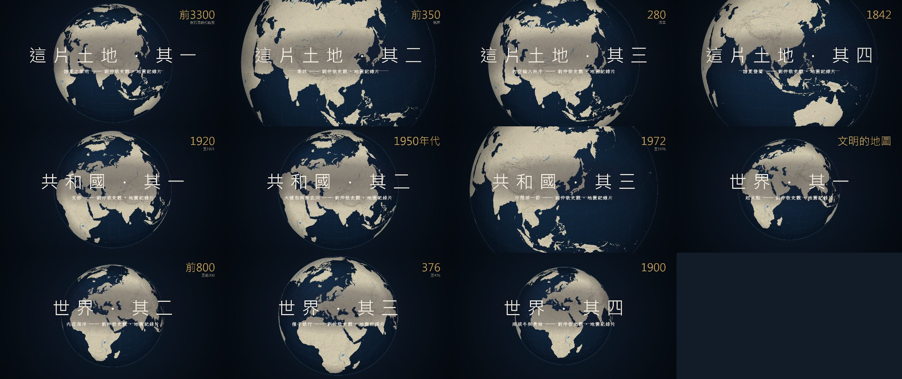

<div align="center">

# Liu Zhongjing's History, in Maps

**Eleven animated map documentaries on the history of the Chinese mainland, the People's Republic and the world as Liu Zhongjing (劉仲敬) reads it, drawn in code on a WebGL and d3-geo globe and rendered frame by frame in headless Chrome.**



</div>

The ideas and the quotations are Liu Zhongjing's. The maps are built from public-domain Natural Earth data; no image or video generation model, photograph or stock footage is used for the picture. Companion series: [Liu Zhongjing in Watercolour](https://github.com/ChanMeng666/lzj-watercolor-films).

## The films

### Dawn of the Xia States 《諸夏之黎明》
▶ Watch on YouTube: https://youtu.be/uJd7ewPNMFY

### The Qin System 《秦政》
▶ Watch on YouTube: https://youtu.be/KQ_b0XPLwPU

### Order Imported from Inner Asia 《內亞輸入秩序》
▶ Watch on YouTube: https://youtu.be/4c6nYTUqOLM

### The Xia States Speak 《諸夏發聲》
▶ Watch on YouTube: https://youtu.be/WyrCKbSdGkU

### The Branch 《支部》
▶ Watch on YouTube: https://youtu.be/M9BZTNBXwxY

### Gift Box and Bottomless Pit 《大禮包與無底洞》
▶ Watch on YouTube: https://youtu.be/hdcYtqPiQaI

### The Missing Middle 《中間那一節》
▶ Watch on YouTube: https://youtu.be/8TsZnOn1j-0

### Where the Fire Started 《起火點》
▶ Watch on YouTube: https://youtu.be/I5XjoNquyzc

### The Inner Asian Ocean 《內亞海洋》
▶ Watch on YouTube: https://youtu.be/RnMtqdJTSk4

### The Seed Bank 《種子銀行》
▶ Watch on YouTube: https://youtu.be/J7JfhzHmBos

### Two Bulls and a Frog 《兩頭牛與青蛙》
▶ Watch on YouTube: https://youtu.be/gZBkrnX34X4

## How it's made

- **Geography from open data.** `scripts/build_geo.py` turns Natural Earth countries, provinces, rivers, lakes and shaded relief into simplified TopoJSON (mapshaper) in `data/topo/`; historical regions are named groups of modern units in `web/lib/regions.js`.
- **A film is data.** Each file in `web/films/` is a list of `beat({...})` calls in a small DSL (`web/lib/dsl.js`): a camera fit or flight, a year label, a chapter seal, region fills, campaign arrows, streams, walls, fronts and captions.
- **The renderer.** `web/lib/map.js` draws an orthographic globe with d3-geo and Canvas/WebGL: sea gradient, graticule, relief, borders, then rivers and province lines that appear as the camera zooms in.
- **Frames and score.** `render.mjs` slices the timeline across parallel headless Chrome pages (playwright-core) and pipes 1920×1080 frames to ffmpeg; `audio/compose.py` writes one cue per scene from recorded instrument samples.
- **Quotations are sourced.** Every captioned quotation is verbatim and carries its source on screen; all are listed in [docs/STORYBOARD.md](docs/STORYBOARD.md). Borders are present-day Natural Earth boundaries used as a stage, not claims about sovereignty.

## Make your own

Needs Node 18+, Python 3.11+ (numpy, scipy, soundfile, soxr), ffmpeg and Chrome. The map data is committed; the instrument sample libraries are not: point `LZJ_INSTRUMENTS` at your own copy (see `audio/lib/sampler.py`).

```bash
npm install
node scripts/timing.mjs > audio/timing.json
python audio/compose.py china1         # audio/out/china1.wav
node render.mjs china1 --stills 10,40  # single frames to out/stills/
node render.mjs china1 --workers 6     # out/china1.mp4
```

## Licence

- **Code:** MIT ([LICENSE](LICENSE)).
- **Films, scores, map designs and images made by Chan Meng:** CC BY 4.0 ([LICENSE-MEDIA.md](LICENSE-MEDIA.md)).
- **Excluded:** the quoted text, which is Liu Zhongjing's and credited to him; Natural Earth data (public domain, naturalearthdata.com); d3-geo, d3-array, internmap and topojson-client (ISC) and other npm libraries (their licences); fonts (LXGW WenKai TC, Noto Serif TC: SIL OFL 1.1); the Lemo-Opuscar sampler helpers (MIT, © 2026 LemoLab); instrument samples (their own licences, not redistributed). Full list: [NOTICE.md](NOTICE.md).

More detail: [docs/overview.md](docs/overview.md)
