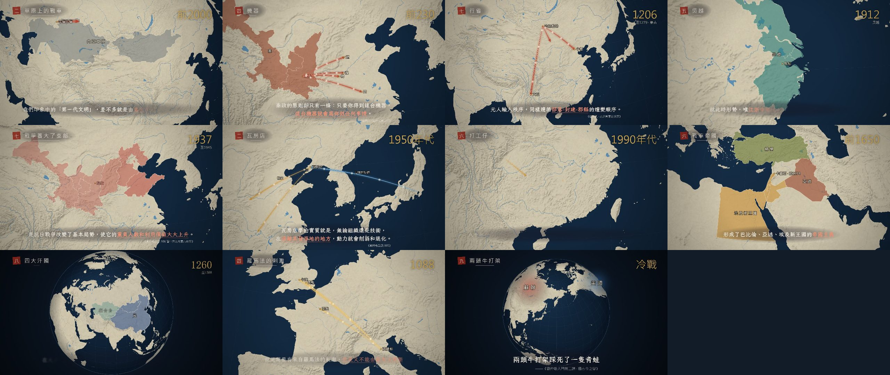

<p align="center">
  
</p>

# Liu Zhongjing's History, in Maps

**Eleven animated map documentaries that retell the history of the land now called China, of the People's Republic, and of the world as the historian and political theorist Liu Zhongjing (劉仲敬) reads it.** The maps are drawn entirely in code: a WebGL and Canvas renderer flies a camera over an orthographic globe built from public-domain Natural Earth data, colours historical regions, draws campaign arrows, trade streams, walls and fronts, and keeps a year counter in the corner. Headless Chrome renders every frame in parallel and ffmpeg adds an original score played on recorded instruments. No image or video generation model, photograph or stock footage is used for the picture.

This is the companion to [Liu Zhongjing in Watercolour](https://github.com/ChanMeng666/lzj-watercolor-films). Those films explain his ideas; these films put the ideas on the map. Each film has 10 to 12 chapters. Every captioned quotation is verbatim from his books, lectures, interviews or posts, and carries its source on screen. Where a scene gives a plain historical fact rather than his reading, it is labelled as such.

## The films

### This Land（這片土地）: four films on the East Asian mainland

| # | Title | Period | Argument | Length |
|---|---|---|---|---|
| 1 | 《諸夏之黎明》 *Dawn of the Xia States* | c. 3300 BC – 660 BC | A broken, multi-ethnic mainland. Chariots arrive from the steppe and Shang rules from strongholds. Zhou builds feudalism through military colonies. The Xia states are islands in a barbarian sea. | 2:13 |
| 2 | 《秦政》 *The Qin System* | c. 450 BC – AD 220 | Commanderies begin as patches on the frontier. The registered household atomises society. The machine serves whoever holds it. The steppe answers, mercenaries march, and the grid falls apart. | 2:17 |
| 3 | 《內亞輸入秩序》 *Order Imported from Inner Asia* | 280 – 1912 | From Yongjia to the Xianbei north and the Wuchuan garrison, through Sui-Tang, Liao, Jin, the Yuan provinces and the Ming, to a Qing that "faced China from an Inner Asian base". | 2:30 |
| 4 | 《諸夏發聲》 *The Xia States Speak* | 1842 – 1949 | The Royal Navy replaces Inner Asia as the source of order. Provinces come first and the republic after. Wu-Yue, Ba-Shu, Hunan, Yunnan, Guangdong, Manchuria and Taiwan each have their own resources. | 2:42 |

### The Republic（共和國）: three films on the PRC

| # | Title | Period | Argument | Length |
|---|---|---|---|---|
| 5 | 《支部》 *The Branch* | 1920 – 1953 | A small Comintern branch, money and discipline from Moscow, the party-state template, the nodes of 1928 and 1937, the Manchurian party, and why Korea was not a node. | 2:30 |
| 6 | 《大禮包與無底洞》 *Gift Box and Bottomless Pit* | 1950 – 1972 | Manchuria as a prize for Moscow, the 156 projects, Wafangdian, the Third Front, the factions of the Cultural Revolution, and the 1972 node. | 2:15 |
| 7 | 《中間那一節》 *The Missing Middle* | 1972 – today | Opening the sluice gate, importing the American order to the coast, special zones, round-tripped capital, migrant workers, "the last link in industrial obsolescence", and the end of technology transfer. | 2:15 |

### The World（世界）: four films on world history

| # | Title | Period | Argument | Length |
|---|---|---|---|---|
| 8 | 《起火點》 *Where the Fire Started* | c. 3500 BC – 330 BC | The "greater Europe" core and its four secondary zones. Sumerian city-states, chariots, the Indo-European waves, Persia. | 2:30 |
| 9 | 《內亞海洋》 *The Inner Asian Ocean* | 800 BC – AD 1500 | The second generation of civilisations. Rome and Han, the Xiongnu, Sogdians and Sasanians, the Turks, the Mongols, and the sea route's return. | 2:19 |
| 10 | 《種子銀行》 *The Seed Bank* | 376 – 1789 | The church that would not die, the multi-centred Latin world, Roman law, England as a seed of Germanic feudalism, and America as England's own seed. | 2:26 |
| 11 | 《兩頭牛與青蛙》 *Two Bulls and a Frog* | 1842 – today | The British gold standard, the world wars, the dollar cycle, the Cold War, and "two bulls fighting trample a frog". | 2:41 |

The year, chapter, quotation and source of every scene are listed in [`docs/STORYBOARD.md`](docs/STORYBOARD.md).

<p align="center"></p>

## How a frame is made

1. **Geography.** `scripts/build_geo.py` downloads Natural Earth 1:50m countries, land, rivers and lakes and 1:10m provinces and states. It simplifies them with mapshaper into TopoJSON in `data/topo/`. Chinese provinces (with Taiwan) and US states get their own `CN:` and `US:` ids so regions can be built from them. The Natural Earth shaded relief becomes a WebGL texture that is multiplied over the land.
2. **A film is data.** Each file in `web/films/` is a list of `beat({...})` calls written with a small DSL (`web/lib/dsl.js`). A beat sets a camera, which is either a bounding box to fit or keyframes to fly through, along with a year label, a chapter seal and its layers. Layers are region fills that fade or grow, hatching, labels, pulsing cities, progressive arcs with flowing light, particle streams, zones, walls and fronts, plus captions. Historical regions are named groups of modern units in `web/lib/regions.js`.
3. **The renderer.** `web/lib/map.js` draws an orthographic globe with d3-geo: a sea gradient, graticule, land with relief, borders, then rivers, lakes and province lines that appear as you zoom in. The thematic layers go on top. The camera zooms out in the middle of long flights, so the viewer keeps their bearings. Scenes crossfade, and captions use the same typography engine as the watercolour films.
4. **Frames.** `render.mjs` starts several headless Chrome pages, gives each a slice of the timeline, captures 1920×1080 frames at 30 fps, and pipes them to ffmpeg.
5. **Score.** `scripts/timing.mjs` exports scene boundaries. `audio/compose.py` writes one cue per scene from recorded-instrument samples: a pentatonic minor with zither, erhu and harp for *This Land*, strings, brass and marches in A minor for *The Republic*, and a pentatonic major with horns and harp for *The World*. A soft timpani stroke marks every chapter change.

## Running it

Requirements: Node 18+, Python 3.11+ with numpy, scipy, soundfile and soxr, ffmpeg and Chrome. You also need the instrument sample libraries described in the sampler (`LZJ_INSTRUMENTS` points to them). Rebuilding the geography needs mapshaper (`npm i -g mapshaper`).

```bash
npm install
python scripts/build_geo.py          # optional: data/topo is committed
node scripts/timing.mjs > audio/timing.json
python audio/compose.py all          # writes audio/out/<film>.wav
node render.mjs china1 --workers 6   # writes out/china1.mp4
node render.mjs prc2 --stills 10,40  # single frames to out/stills/
node scripts/storyboard.mjs          # regenerates docs/STORYBOARD.md
```

To preview a film in a browser, serve the repository root and open `/web/player.html?film=world3`.

## Notes on the maps

- Borders are present-day Natural Earth boundaries, used as a stage for historical regions. Ancient polities are approximated by groups of modern provinces or countries. These are not claims about sovereignty, past or present.
- The films present Liu Zhongjing's interpretation. Where his reading departs from the mainstream (for example, that Shang and Zhou were "late Mesopotamian" civilisations), the scene says it is his reading.
- Simplified-script quotations are converted to Traditional characters and full-width punctuation by `scripts/s2t.py`, so the captions look consistent. The wording is not changed.

Third-party data, code, fonts and samples are listed in [`NOTICE.md`](NOTICE.md).
